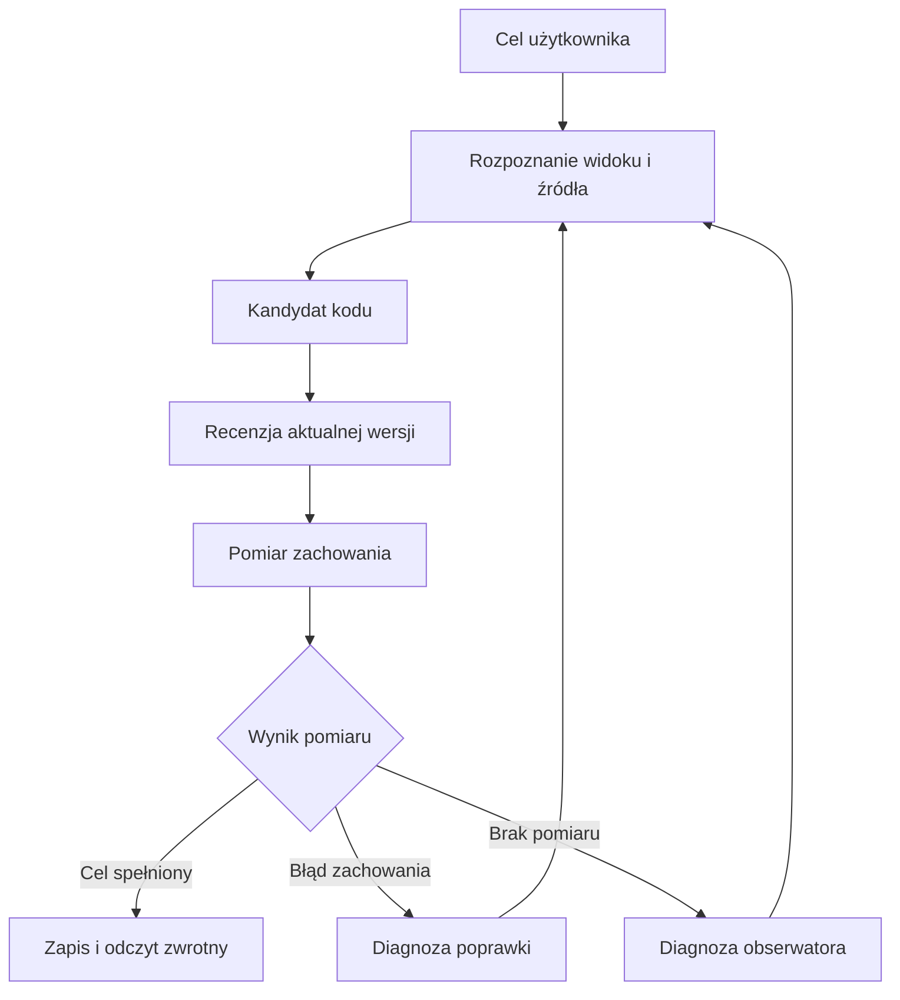

# Pusty nagłówek, pełna pętla

## Jak rozwój 0!n ujawnił granice rozumowania, percepcji i pamięci systemu wieloagentowego AI

**Autor projektu:** Sebastian Wieremiejczyk (Cha0s)  
**Data opracowania:** 28 października 2026 r.  
**Rodzaj materiału:** techniczny write-up z procesu rozwojowego  
**Zakres:** kolejne próby zmiany interfejsu, poprawki R52–R54, historia rozwoju i obsługa Git.

> Niewielka zmiana w interfejsie może sprawdzić całą architekturę agenta: czy rozumie cel, odnajduje właściwy kod, ocenia aktualną propozycję, mierzy właściwy rezultat i potrafi bezpiecznie zapisać zmianę.

### Nagranie udanej misji

**Film:** [0!n — nagranie udanej misji systemu wieloagentowego AI](https://youtu.be/NOi9u2gniys).

[](https://youtu.be/NOi9u2gniys)

Nagranie jest punktem odniesienia dla końcowego rezultatu opisanego przez autora projektu. Poniższy tekst rekonstruuje także wcześniejsze, nieudane próby i zmiany, które do niego doprowadziły.

## 1. Zaczęło się od kilku słów w nagłówku

Jedno z zadań realizowanych w 0!n dotyczyło zmiany napisu w panelu głównym. Kolejna misja szła dalej:

> „Nie chcę by w nagłówku panelu głównego był jakikolwiek napis, niech to pole będzie puste”.

Dla programisty, który zna strukturę aplikacji, mogłaby to być drobna edycja. W systemie wieloagentowym to pełne zadanie poznawcze i wykonawcze. Trzeba ustalić, co użytkownik nazywa nagłówkiem, zidentyfikować element widoku, odnaleźć jego źródło, przygotować zmianę i sprawdzić efekt w uruchomionej aplikacji. Następnie trzeba zapisać dokładnie tę wersję, którą poddano ocenie.

W kolejnych próbach system potrafił wygenerować potrzebny kod, a mimo to nie zawsze umiał doprowadzić zadanie do końca. Raz błędnie oceniał kandydata. Innym razem sprawdzał nieistniejący element. Później zatrzymał wykonanie, ponieważ jego własna reprezentacja kontekstu nie nadążyła za nową obserwacją.

To doświadczenie pokazało, jak dużo rozwoju systemu AI odbywa się pomiędzy wywołaniami modeli: w kontraktach, identyfikacji wersji, przepływie obserwacji i warunkach dopuszczenia kolejnego działania.

## 2. Co opisuje ten write-up

Materiał opiera się na przekazanych logach misji, historii diagnoz i raportów wydań R52–R54, informacji autora o udanej końcowej próbie oraz wybranych dokumentach wiedzy projektu LION. Dokumenty LION służą tutaj do wyjaśnienia zasad architektury; ich treść nie jest dowodem wdrożenia wszystkich tych zasad w 0!n.

W trakcie opracowania nie wykonano ponownie opisanych testów ani audytu pakietów ZIP. Liczby testów i szczegóły odczytów kodu podano jako wyniki raportowane podczas wcześniejszych prac. Nie była dostępna transkrypcja filmu, dlatego tekst nie przypisuje mu konkretnych scen ani znaczników czasu.

Rozróżnienie jest istotne dla całego artykułu: log dokumentuje przebieg, raport opisuje wynik wcześniejszego sprawdzenia, a nagranie i relacja operatora odnoszą się do konkretnej próby użytkowej. Żadne z tych źródeł osobno nie ustanawia uniwersalnej skuteczności systemu.

## 3. Układ pracy: modele proponują, system wykonuje i obserwuje

W logach występują role koordynatora problemu, projektanta i recenzenta planu, workera kodu, recenzenta zakresu, projektanta sprawdzeń, obserwatora kandydata i krytyka. Role korzystają z modeli LOCAL oraz SaaS. Nie oznacza to, że każda rola jest odrębnym, stale działającym procesem lub niezależną instancją poznawczą.

Ich współpraca wymaga wspólnego odniesienia do celu i źródeł. Worker tworzy propozycję. Recenzent ocenia konkretną wersję tej propozycji. Narzędzie wykonuje pomiar. Warstwa wykonawcza dopuszcza zapis i odczytuje rezultat. Sama wypowiedź modelu nie zastępuje żadnego z tych efektów.

Powtarzający się w logach komunikat dobrze pokazuje tę granicę:

```text
Propozycja zgodna z kontraktem · działanie oczekuje wykonania
```

Zgodność z kontraktem oznacza, że propozycja nadaje się do dalszego przetwarzania. Nie oznacza, że operacja już się odbyła ani że osiągnięto cel użytkownika.

Poniższy diagram przedstawia schemat odpowiedzialności wynikający z analizowanego doświadczenia. Jest uproszczeniem, a nie pełną mapą uruchomionych komponentów:



## 4. Pierwsza awaria: poprawka istniała, lecz została błędnie odrzucona

W jednym z wcześniejszych przebiegów pierwszy kandydat zmieniał niewłaściwe miejsce. Późniejszy szkic usuwał już napis „Panel A” z właściwego nagłówka. Według raportu porównania zapisanych kandydatów recenzent odrzucił tę późniejszą wersję, twierdząc, że napis nadal w niej występuje.

Diagnoza wskazała utratę spójnego obrazu przedmiotu recenzji: ocena nie odnosiła się prawidłowo do aktualnego kodu kandydata. To poważniejszy problem niż pojedyncza błędna opinia. Jeżeli recenzent ocenia inną wersję niż worker właśnie przygotował, kolejne iteracje naprawiają stan, który przestał istnieć.

Równolegle test używał selektora `.panel-header`, którego nie było w badanym interfejsie. Taki test nie ustalał, czy zmiana spełnia cel. Ustalał jedynie, że przyjęta metoda dotarcia do elementu jest nieskuteczna.

Pojawił się również błąd odczytu źródła: offset w oryginalnym tekście pomylono z offsetem wewnątrz wybranego zakresu. Komunikat narzędzia zawierał:

```text
PROBLEM_SOURCE_SLICE: offset is in original text; limit must be 1..10000
```

Każdy z tych problemów dotyczył innej granicy: wersji kandydata, identyfikacji elementu i współrzędnych źródła. W pętli wykonawczej nakładały się jednak na siebie, tworząc wrażenie ogólnej niezdolności do rozwiązania zadania.

### R52: odzyskanie wiarygodnej oceny

Raportowana poprawka R52 objęła przekazywanie aktualnego kodu do recenzji, obserwację DOM po działaniach oraz rozróżnienie błędu zachowania od niemożności wykonania pomiaru. Dodano także ograniczoną diagnostykę przed kolejną edycją.

W kontrpróbach przeglądarkowych rozróżniono pierwszą, nietrafną zmianę od późniejszego szkicu usuwającego nagłówek i zachowującego sprawdzoną nawigację. Zbadano również pytanie testowe, które było zbyt słabe: przechodziło zarówno przed zmianą, jak i po niej.

Ten ostatni przypadek jest szczególnie ważny. Test może poprawnie się uruchamiać i stale zwracać wynik pozytywny, a mimo to nie rozróżniać realizacji celu od jego niespełnienia. Sukces narzędzia testowego nie wystarcza; potrzebna jest trafność samego kryterium.

## 5. Pierwsza udana misja nie zamknęła całej klasy problemów

Po R52 kolejny przekazany log kończył się komunikatem:

```text
Zakończono misję · wynik i zakres sprawdzeń zachowane
```

W raporcie odczytu wyniku wskazano stan `RESULT_READY`, 21 kroków i 26 wywołań modeli. Sprawdzenie przeglądarkowe wykazało nagłówek „Panel Główny”, bez „Panel A”, a odczyt zwrotny potwierdził zgodność zapisanego kodu z kandydatem.

Było to potwierdzenie pełnej ścieżki dla konkretnego celu: generowanie, sprawdzenie, recenzja i zapis. Kolejna misja na tym samym artefakcie — całkowite usunięcie widocznego napisu — ujawniła następne słabości. Zatrzymała się na kroku 39 bez dalszego postępu.

Rozróżnienie obu zadań ma znaczenie. Zamiana jednej etykiety na inną i pozostawienie obszaru nagłówka bez napisu są bliskie semantycznie, lecz wymagają innych kryteriów końcowych. Pierwszy sukces nie dowodził jeszcze poprawnego rozumienia drugiego celu.

## 6. Pusty tytuł i pusty nagłówek to różne warunki

W diagnozie kolejnej próby wskazano, że worker otrzymał fragment opisujący kontekst panelu zamiast kodu jego nagłówka. Później ponownie użyto nieistniejącego selektora. Ograniczony odczyt stał się też podstawą do kwestionowania właściciela widoku.

Wniosek jest praktyczny: przed edycją trzeba ustalić związek pomiędzy obiektem widocznym dla użytkownika, jego reprezentacją w DOM i miejscem w źródle. Samo podobieństwo słów „panel”, „nagłówek” i „tytuł” nie ustanawia tego związku.

Raportowane sprawdzenie widoku rozpoznało rzeczywisty element `#cm-title` i powiązało go ze źródłem. To jednak nadal nie rozstrzygało całego zakresu życzenia użytkownika. Pusty element `h1` może znajdować się w obszarze, który zawiera inne widoczne napisy.

| Interpretacja celu | Co trzeba sprawdzić | Jak powstaje fałszywy sukces |
| --- | --- | --- |
| Usunięcie konkretnego napisu | Czy wskazany tekst zniknął z właściwego miejsca | Ten sam napis usunięto z innego widoku |
| Opróżnienie tytułu | Czy właściwy element tytułu nie wyświetla tekstu | Tytuł jest pusty, ale obok nadal widnieje etykieta |
| Brak napisów w obszarze nagłówka | Czy uzgodniony obszar nie zawiera widocznych napisów | Test bada wyłącznie jeden element potomny |
| Zachowanie pustego pola | Czy obszar nadal istnieje i układ zachowuje oczekiwane działanie | Cały nagłówek usunięto, zmieniając strukturę panelu |

Nie należy automatycznie usuwać wszystkich sąsiadujących kontrolek lub ich nazw dostępności. Rozpoznanie ma ustalić, gdzie przebiega granica obszaru opisanego przez użytkownika. Dopiero ten zakres można zamienić na warunek pomiaru.

Właśnie tutaj „percepcja” systemu nabiera technicznego znaczenia. Jest zdolnością do zbudowania sprawdzalnego powiązania między widokiem, intencją i źródłem, a nie samą deklaracją modelu, że rozumie ekran.

## 7. Wynik testu musi mówić, co rzeczywiście ustalono

Jeżeli narzędzie nie znajduje selektora, nie ma jeszcze podstaw do stwierdzenia, że aplikacja nie spełnia celu. Nie ma też podstaw do stwierdzenia sukcesu. Nie wykonano właściwego pomiaru.

Dlatego w pętli potrzebne są co najmniej trzy rozróżnienia znaczeniowe:

| Wynik | Znaczenie | Uzasadniony następny krok |
| --- | --- | --- |
| Cel spełniony | Pomiar dotyczył właściwego obiektu i potwierdził warunek | Ocena całości oraz dopuszczenie zapisu |
| Cel niespełniony | Pomiar dotyczył właściwego obiektu i wykazał rozbieżność | Diagnoza zachowania i poprawka kodu |
| Brak pomiaru | Nie udało się dotrzeć do obiektu lub wykonać sprawdzenia | Naprawa sposobu obserwacji i ponowny pomiar |

Tabela opisuje kontrakt znaczeniowy, nie deklaruje nazw enumów w implementacji. Kluczowa jest konsekwencja: błąd obserwatora powinien kierować do diagnostyki obserwatora. Inaczej system zaczyna zmieniać poprawny kod, aby zaspokoić wadliwy test.

Dobrym sprawdzianem kryterium jest kontrpróba na stanie sprzed zmiany. Jeżeli oryginał jawnie niespełniający celu również przechodzi test, trzeba poprawić kryterium. Samo powtórzenie pomiaru po poprawce nie usuwa tego problemu.

## 8. Stagnacja, długie wywołanie i zatrzymanie przez kontrolę spójności

W dostarczonych przebiegach występowały wielokrotne odczyty kontekstu, rewizje planu, ponowne odkrywanie źródeł i przełączanie perspektywy LOCAL/SaaS. Widoczna aktywność nie zawsze oznaczała redukcję niepewności.

Jedna z prób kończyła się powodem:

```text
OBSERVATIONS_DID_NOT_REDUCE_UNCERTAINTY
```

Taki wynik mówi o braku dopuszczalnego postępu według kontroli pętli. Nie jest sam w sobie dowodem deadlocku na poziomie procesów lub blokad. Do rozpoznania deadlocku potrzebny byłby stan oczekiwań i zależności wykonania.

Podobnie długie oczekiwanie może oznaczać trwające wywołanie modelu, problem transportu albo operację oczekującą na narzędzie. Dla operatora interfejs powinien pokazywać te stany oddzielnie, z ostatnią rzeczywistą operacją i przyczyną zatrzymania.

Nie wykazano, że zwiększenie budżetu rozwiązałoby opisane awarie. Większy budżet pozwoliłby dłużej oceniać nieaktualny kod lub odpytywać niewłaściwy element. W tym przypadku naprawy dotyczyły jakości i kolejności informacji.

## 9. R53: historia rozwoju stała się częścią architektury

Prace nad kolejną poprawką rozszerzyły zakres poza rozpoznanie nagłówka. Pojawiło się pytanie: jak misja zmieniająca aplikację ma zachować pamięć tego, co zaproponowała, sprawdziła, odrzuciła i zastosowała?

Dotychczasowa zakładka „Dotychczasowe misje” w dużej mierze powtarzała widok generacji. Sama lista dawnych przebiegów nie wystarcza do odpowiedzi, dlaczego obecny kod wygląda właśnie tak, jak wygląda.

W R53 raportowano wprowadzenie Historii obejmującej wykonania, gałęzie, commity, przegląd zmian, porównania i rollback. Powiązano również plany architektury z wersjami kodu. Odrzucone propozycje miały pozostać dostępne, aby można było porównywać kierunki i rekonstruować przyczyny zatrzymania.

To zmienia funkcję historii: z archiwum komunikatów w narzędzie odtwarzania rozwoju.

### Git jako pamięć strukturalna

Podczas diagnozy stwierdzono, że badany projekt nie miał jeszcze pierwszego commita ani skonfigurowanego repozytorium zdalnego. Przygotowywana obsługa musiała zatem uwzględniać stan początkowy, zamiast zakładać gotowy obieg GitHub.

Według raportów R53 propozycja mogła otrzymać własną gałąź i commit bez przełączania roboczego projektu. Zastosowanie pozostawało odpowiedzialnością dotychczasowego właściciela źródeł. Wycofanie tworzyło kolejny commit i odtwarzało plik. W kontrolowanej próbie indeks użytkownika pozostał identyczny bajt po bajcie.

Zgłoszono również blokowanie zastosowania po wykryciu konfliktu źródła, zmiany wersji planu architektury lub zmiany referencji Git. Takie warunki wiążą zgodę na zapis z konkretnym stanem, zamiast traktować ją jako bezterminową aprobatę dowolnej późniejszej wersji.

Lokalny przegląd zmian nie był zdalnym pull requestem. Zdalny PR wymagał osobno przygotowanej historii repozytorium, `origin` i uwierzytelnienia. W opisywanym doświadczeniu nie ma podstaw do deklarowania zakończonego obiegu publikacji i merge na GitHub.

### Trzy warstwy pamięci

| Warstwa | Co przechowuje | Na jakie pytanie odpowiada |
| --- | --- | --- |
| Git i wersje artefaktów | Treść zmian, pokrewieństwo wersji, propozycje i cofnięcia | Co się zmieniło i względem czego? |
| Historia misji i obserwacji | Cel, operacje, wyniki sprawdzeń, oceny i powody zatrzymania | Jak powstała ta wersja i co o niej zmierzono? |
| Wiedza architektoniczna | Założenia, relacje, ograniczenia i zamierzony kierunek | Dlaczego wybrano tę zmianę i do czego ma prowadzić? |

Żadna z warstw nie zastępuje pozostałych. Commit bez wyniku sprawdzenia nie dowodzi poprawności. Wynik testu bez identyfikacji kandydata może odnosić się do innej wersji. Plan opisuje zamiar, ale nie ustanawia działającej implementacji.

Docelowo połączenie tych warstw pozwala przechodzić od widoku aplikacji do źródła, od źródła do commita, od commita do misji, a od misji do przesłanek architektonicznych. Jest to kierunek projektowy wynikający z doświadczenia; nie należy utożsamiać go z dowodem ukończenia pełnej integracji wszystkich komponentów LION.

## 10. Błąd interfejsu ujawnił ten sam problem tożsamości stanu

Osobnym zgłoszeniem było znikanie Analizy funkcjonalności. Po jej otwarciu interfejs na chwilę przechodził do innego widoku, a następnie analiza samoczynnie się wyłączała.

W raporcie próby aplikacyjnej wskazano, że celowo opóźniona odpowiedź modelu sceny została po poprawce odrzucona, a wybrana analiza pozostała widoczna. Poprawka dotyczyła więc obsługi odpowiedzi, która przestała odpowiadać aktualnemu wyborowi użytkownika.

To ta sama klasa problemu, która wystąpiła przy recenzji kandydata: treść może być poprawna dla wcześniejszego stanu, a mimo to nie nadawać się do zastosowania w stanie obecnym. Tożsamość żądania, wersja widoku i aktualny wybór użytkownika są częścią warunku dopuszczenia odpowiedzi.

Test takiej granicy powinien celowo zmieniać kolejność odpowiedzi. Zwykła próba z szybkim modelem może nigdy nie odtworzyć wyścigu.

## 11. R53 wprowadził też regresję: obserwacja wyprzedziła reprezentację

Po kolejnej próbie operator opisał zachowanie jako możliwe zapętlenie lub deadlock. Diagnoza wskazała jednak misję zatrzymaną, bez aktywnego wywołania modelu i bez oczekującej operacji. Źródła nie zostały zmienione.

Powodem był:

```text
PROBLEM_SEMANTIC_CONTEXT_CHANGED
```

Według odtworzenia błędu nowa obserwacja widoku została dopisana, ale następne wywołanie sprawdzało jeszcze poprzednią reprezentację kontekstu. Kontrola spójności zobaczyła rozbieżność i zatrzymała przejście.

Kontrola nie powinna zostać po prostu wyłączona. Jej zadaniem jest blokowanie pracy na nieaktualnym kontekście. Problemem była kolejność aktualizacji własnego stanu systemu.

### R54: sprawdzenie całego przejścia

Poprawka R54 zapisywała obserwację i odświeżała reprezentację przed dopuszczeniem następnego wywołania. Dodano test przechodzący przez całą tę sekwencję. Wcześniejsze testy sprawdzały jej części osobno.

Raportowany przebieg kontrolowany zachowywał obserwację i dopuszczał dalsze wywołanie. Jednocześnie testy nadal odrzucały kontekst zmieniony przed odczytem. To istotne rozróżnienie: poprawiono legalne przejście, zachowując wykrywanie rzeczywistej nieaktualności.

Ten przypadek pokazuje ograniczenie samych testów komponentów. Zapis obserwacji, budowa reprezentacji i walidacja mogą działać poprawnie w izolacji. Awaria powstaje dopiero wtedy, gdy konsument odczyta stan pomiędzy aktualizacjami.

## 12. Jakie sprawdzenia raportowano

Poniższe zestawienie zachowuje liczby z wcześniejszych raportów wydań. Nie stanowi nowego wykonania tych zestawów ani niezależnej weryfikacji ich surowych wyników.

| Wydanie | Windows | Linux | Dodatkowy raportowany zakres |
| --- | ---: | ---: | --- |
| R52 | 1538 | 1570 | Sześć kontrprób przeglądarkowych, kontrole interfejsu HTTP i geometrii, instalacja i rollback na kopii projektu |
| R53 | 1558 | 1590 | Próby nagłówka i Historii, opóźniona odpowiedź widoku, kontrolowane operacje Git, instalacja, ponowne zastosowanie i rollback |
| R54 | 1564 | 1596 | Przejście od obserwacji do aktualnego kontekstu i następnego wywołania, odrzucanie kontekstu nieaktualnego, instalacja i rollback |

W raportach pełne zestawy zakończyły się bez błędów. Sama liczba testów nie mówi jednak, czy sprawdzono właściwą granicę. Regresja R53 wystąpiła mimo szerokiej regresji, ponieważ brakowało testu złożonego przejścia stanu.

Ważna była także walidacja samej dystrybucji poprawki. W R52 wykryto przekroczenie limitu wejścia SaaS o 156 znaków po dodaniu opisu recenzji. Usunięto powtórzoną instrukcję, zachowując dane i kontrakt. W R53 zgłoszono aktualizację podpisów plików profilu uruchamiania oraz obsługę poprzedniego profilu na ścieżce migracji.

Te przypadki pokazują, że poprawność kodu, rozmiar rzeczywiście wysłanego wejścia i zgodność instalatora są różnymi przedmiotami sprawdzenia. Wynik jednego z nich nie przenosi się automatycznie na pozostałe.

## 13. Co oznacza końcowy sukces

Po R54 autor projektu potwierdził, że misja się udała, i udostępnił nagranie: [obejrzyj film](https://youtu.be/NOi9u2gniys).

W kontekście całej sekwencji sukces oznacza realizację konkretnego celu użytkowego po usunięciu zidentyfikowanych przeszkód. Jest mocniejszym sygnałem niż sama zgodna ze schematem propozycja workera lub zielony test izolowanego komponentu.

Nie należy przypisywać końcowej misji liczników 21 kroków i 26 wywołań. Te liczby pochodziły z wcześniejszej udanej próby zmiany napisu na „Panel Główny”. Dla końcowej próby z pustym nagłówkiem w przekazanym materiale nie podano analogicznego kompletnego zestawu liczników.

Wartość tego doświadczenia polega również na zachowaniu wcześniejszych niepowodzeń. Bez nich udana demonstracja ukrywałaby wiedzę o tym, dlaczego system wcześniej odrzucał poprawny kod, źle mierzył zachowanie lub zatrzymywał własne przejścia.

## 14. Wnioski dla projektowania systemów wieloagentowych

### Aktualny przedmiot oceny musi być jednoznaczny

Recenzja powinna wiązać się z konkretnym kandydatem i jego bazą. Identyfikator misji nie wystarcza, jeżeli w jej obrębie powstaje kilka wersji. Zmiana kandydata wymaga ponownej oceny tych własności, które zależą od zmienionych bajtów.

### Obserwacja jest wejściem do rozumowania

Wynik narzędzia musi zawierać informację o tym, co zmierzono, na jakim stanie i z jakim ograniczeniem. Brak elementu DOM nie może zostać bezpośrednio przetłumaczony na wadę implementacji. Obserwator współtworzy jakość decyzji następnego agenta.

### Lokalność i wielkość modelu nie ustanawiają wiarygodności

Przełączenie LOCAL/SaaS może dać inną propozycję, ale nie naprawia automatycznie nieaktualnego wejścia. Dwa modele czytające ten sam błędny obraz stanu mogą zgodnie powtórzyć ten sam błąd. Wspólne źródło pozostaje jednym korzeniem dowodowym.

### Postęp trzeba mierzyć zmianą wiedzy lub artefaktu

Kolejny odczyt ma sens, jeżeli odpowiada na nowe pytanie, poszerza zakres źródła lub sprawdza konkretną hipotezę. Dalsze planowanie powinno zmieniać decyzję albo usuwać lukę. Liczba komunikatów nie jest miarą postępu.

### Pamięć rozwoju powinna zachować także porażki

Odrzucony kandydat może zawierać poprawną zmianę i błędną ocenę. Nieudana misja może ujawnić wadliwe kryterium testowe. Zachowanie tych relacji pozwala rozwijać system na podstawie przyczyn, zamiast uczyć go jedynie końcowych etykiet „sukces” i „porażka”.

### Domknięcie zadania wymaga odczytu efektu

Propozycja, recenzja, zapis i odczyt zwrotny są różnymi zdarzeniami. System powinien potrafić wykazać, że zapisany rezultat odpowiada sprawdzonemu kandydatowi. W przeciwnym razie może poprawnie przetestować jedną wersję i zastosować inną.

## 15. Kierunek dalszego rozwoju

Opisane doświadczenie uzasadnia dalsze rozwijanie połączenia historii, Git i wiedzy architektonicznej. Następny krok powinien dostarczać konkretne przejścia i ich testy, zamiast ograniczać się do nowej instrukcji dla modelu.

Najbardziej wartościowe kierunki to:

1. **Trwałe wiązanie celu, kandydata i pomiaru.** Każda ocena powinna pozwalać ustalić wersję kodu, zakres celu i metodę sprawdzenia.
2. **Przegląd kompletnej misji w Historii.** Operator powinien przechodzić od rezultatu do diffu, testów, odrzuconych propozycji i przesłanek planu.
3. **Pełny obieg zdalnego PR.** Osobno należy potwierdzić publikację gałęzi, uruchomienie CI, przegląd i dopuszczenie merge dla właściwego repozytorium.
4. **Testy nieaktualnych i spóźnionych wyników.** Powinny obejmować zmianę widoku, kandydata, źródła i reprezentacji kontekstu podczas trwającej operacji.
5. **Kontrpróby dla kryteriów sukcesu.** Test musi odrzucać znany stan niespełniający celu, zanim zostanie użyty jako podstawa akceptacji.
6. **Powtarzalne próby z rzeczywistymi modelami.** Kolejne zadania powinny sprawdzić, czy poprawki przenoszą się na inne widoki i zmiany, przy zachowaniu danych o ograniczeniach.

Są to kierunki wynikające z analizy, a nie lista funkcji uznanych tutaj za już ukończone.

## 16. Znaczenie tego doświadczenia

Zmiana napisu okazała się testem zdolności systemu do utrzymania wspólnego znaczenia pomiędzy użytkownikiem, modelami, kodem i działającym interfejsem. Każda z ujawnionych awarii zrywała inne połączenie: recenzję z kandydatem, pomiar z obiektem, plan ze źródłem albo kontrolę spójności z bieżącą reprezentacją.

R52 poprawił ocenę i obserwację. R53 rozwinął rozpoznanie elementów oraz pamięć procesu w postaci Historii i obsługi Git, ale wprowadził regresję przejścia kontekstu. R54 skorygował kolejność tego przejścia. Końcowa udana misja pokazała praktyczny rezultat tej sekwencji zmian.

Najważniejszym rezultatem rozwojowym jest lepsza możliwość ustalenia, co system zrobił i dlaczego uznał to za poprawne. W takim ujęciu inteligencja aplikacji obejmuje także rzetelne mierzenie efektu, rozpoznawanie granic własnej wiedzy i zachowanie historii decyzji.

Nagranie pokazujące udaną próbę jest dostępne tutaj: **[0!n — udana misja](https://youtu.be/NOi9u2gniys)**.

---

## Materiały źródłowe i zakres odwołań

1. **Logi misji przekazane przez autora projektu.** Obejmują przebiegi zakończone stagnacją, wcześniejszą udaną zmianę nagłówka oraz informacje o zatrzymaniu kolejnych prób.
2. **Historia diagnoz i raportów wydań R52–R54.** Źródło opisu poprawek, wyników zestawów testowych, kontrprób przeglądarkowych oraz instalacji i rollbacku. W artykule nie zastąpiono tych raportów deklaracją nowego audytu.
3. **Potwierdzenie autora o udanej końcowej misji oraz film:** https://youtu.be/NOi9u2gniys.
4. **Pakiet wiedzy LION RAG 1.5, `lion-rag30-v1.5-r1`:** `04_ARCHITECTURE_AS_IS.md`, `06_SEMANTIC_LANGUAGE.md`, `09_SAAS_LOCAL_COOPERATION.md`, `13_PROVENANCE_MEMORY_AND_EVIDENCE.md`, `16_FAILURE_RECOVERY_AND_OBSERVABILITY.md`. Wykorzystane jako kontekst zasad: rozdzielenia propozycji i efektu, tożsamości kontekstu, pochodzenia dowodów oraz obsługi nieaktualnych wyników.

**Nota metodologiczna:** tekst opisuje studium konkretnego procesu rozwojowego. Wyniki dotyczą wskazanych prób i zakresów sprawdzeń. Kierunki architektury docelowej zostały oddzielone od funkcji i rezultatów raportowanych w tej historii.
